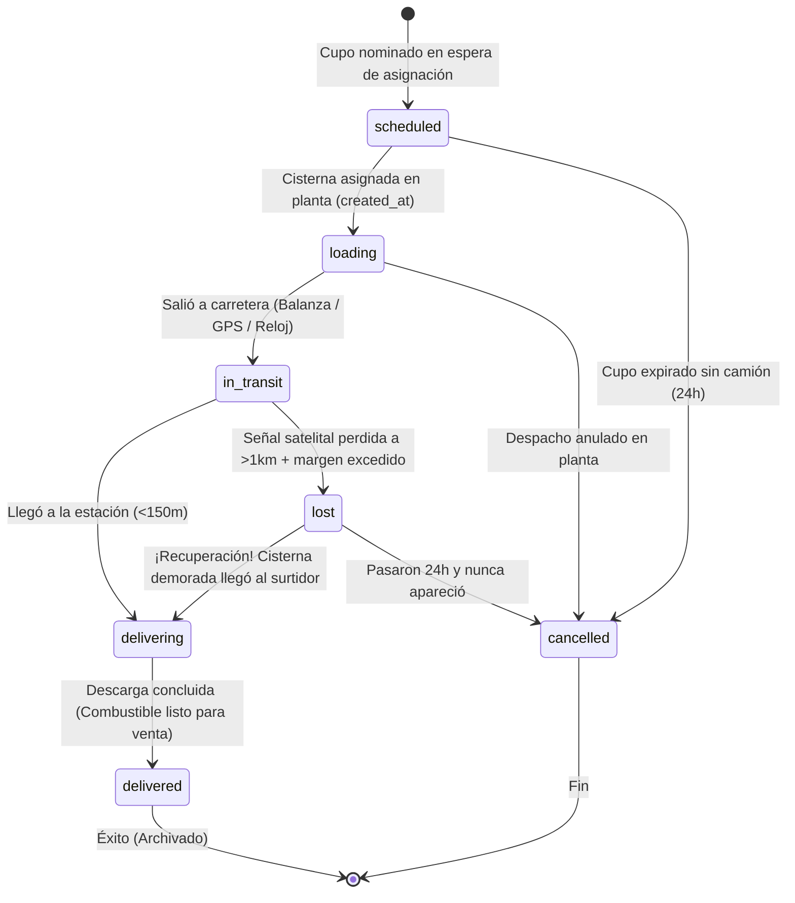
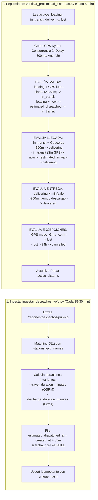

# 🚛 Documento Maestro: Arquitectura Integral del Sistema de Despachos, Telemetría GPS y Seguimiento en Tiempo Real (Surtiveo)

> **Especificación Técnica Definitiva, Diagnóstico de Fuentes Oficiales y Plan de Implementación**  
> **Fecha de Actualización:** 27 de Octubre de 2026  
> **Estado:** Arquitectura Oficial de Producción (Consolidada)  
> **Alcance:** Base de Datos Supabase, Motores de Ingesta y Proximidad Python, API Kyros/YPFB, Radar `active_cisterns` y App Móvil.

---

## 1. Resumen Ejecutivo y Diagnóstico del Problema

### 1.1. Contexto Histórico: El Colapso de la API de la ANH
Hasta el **3 de octubre de 2026**, Surtiveo extraía los despachos de combustible de la API móvil oficial de la Agencia Nacional de Hidrocarburos (ANH):
```text
GET https://vsr11vpr08m22gb.anh.gob.bo:9443/WSMobile/v2/estaciones/9ADE86E5A083423EBE50C051F4DB9778?departamento={dep}&producto={prod}
```
En esa fecha, la ANH retiró del payload el campo `fecha_hora_despacho` (pasó a ser `null`). El scraper anterior descartaba todo registro sin fecha de despacho, lo que paralizó por completo la detección de nuevas cisternas.

### 1.2. Transición a YPFB / Kyros y los Nuevos Cuellos de Botella Detectados
Para reactivar el sistema, se recurrió a la API pública de YPFB provista por Kyros Technologies (`https://nominac.kyros-tech.com/api`). Sin embargo, la primera implementación presentó problemas severos que congelaron cientos de despachos en la base de datos:

1. **204 Despachos Congelados en `loading`**:
   - En `ingestar_despachos_ypfb.py`: si YPFB no registraba la hora efectiva de salida, el despacho se marcaba como `loading`.
   - En `verificar_proximidad_cisternas.py`: el script **solo consultaba** `status IN ('in_transit', 'delivering')`, ignorando totalmente a los despachos en `loading`.
   - Resultado: las cisternas que salían de plantas sin balanza automatizada quedaban con animación de carga infinita en la app móvil durante 3 días hasta ser canceladas por un script de limpieza.
2. **Falsa Asunción de GPS (`has_gps = bool(plate)`):**
   - Se asumía erróneamente que cualquier cisterna con placa boliviana transmitía telemetría en vivo. En la realidad, muchas cisternas privadas o de terceros no transmiten a Kyros.
3. **Bloqueos HTTP 429 y Circuit Breaker Destructivo:**
   - Ráfagas de 8 hilos simultáneos con mutaciones innecesarias de placa (`1123-SYU 1`, `1123SYU`) saturaban el servidor Uvicorn de Kyros. Tras 12 errores consecutivos, el script abortaba el ciclo entero, dejando a oscuras a todo el país.
4. **Radar Satelital Vacío (`active_cisterns` con 0 filas):**
   - La tabla de gemelo digital nunca se mantenía sincronizada con las cisternas en ruta.
5. **Carencia de Tiempos de Entrega / Fin de Descarga:**
   - La tabla `dispatches` solo contemplaba salida y llegada (`dispatched_at`, `estimated_arrival_at`, `confirmed_arrival_at`). No existían columnas nativas para saber cuándo el combustible terminaba de descargarse y estaba listo para la venta, parchándose precariamente dentro de `metadata->>'delivered_at'`.

### 1.3. Componentes Sólidos del Sistema Existente que se Preservan
A pesar de los cuellos de botella temporales y de telemetría, el sistema actual cuenta con componentes de alta ingeniería que se mantienen intactos:
1. **Deduplicación e Idempotencia**: Generación de hash MD5 (`unique_hash`) combinando distrito, fecha, estación, combustible, placa y volumen. Previene duplicados ante múltiples corridas del scraper.
2. **Reclamación de Placas (`reclaim_plate_assignments`)**: Enlaza automáticamente cupos que entraron como `scheduled` sin placa cuando YPFB les asigna placa horas más tarde, evitando crear registros huérfanos.
3. **Homologación de Estaciones en Memoria $O(1)$ (`StationMatcher`)**: Cruce indexado de nombres contra `stations.ypfb_names (text[])`, `stations.name` y `stations.anh_name`. Cero consultas repetitivas a la base de datos y sin falsos positivos difusos.
4. **Caché de Rutas y Topografía (`osrm_routes_cache.json`)**: Persistencia local de polilíneas OSRM y duraciones con curvatura topográfica y factor de camión pesado (`TRUCK_TIME_FACTOR = 1.45` + buffer de balanza de 15 min).

---

## 2. Ingeniería Inversa de la API de Kyros / YPFB (Verificación en OpenAPI)

Se auditó en vivo la especificación OpenAPI de Kyros (`https://nominac.kyros-tech.com/api/openapi.json`, 308 endpoints).

### 2.1. Catálogo de Endpoints Públicos Clave
* **`GET /reportes/despachos/publico`**:
  - Parámetros: `distrito_id` (requerido), `desde`, `hasta`, `periodo` (`hoy`), `page`, `page_size`.
  - **Naturaleza del dato:** Su documentación oficial confirma que representa *“Venta + Transferencia deduplicada: la suma de estas filas son los litros efectivamente despachados”*.
  - **Momento de Inserción:** Cada registro entra a esta API **en el instante en que SIGOPER genera la Orden de Despacho en la planta de YPFB**. Ya es un despacho real con `"despacho_confirmado": true`.
* **`GET /calidad/diagnostico-fechas-despacho`**:
  - **Hallazgo Crítico:** La documentación interna de Kyros revela que en **6 distritos completos** (Bermejo, Camiri, Cobija, Monteagudo, Puerto Suárez, San Julián) `fecha_despacho_efectivo_hora` es **NULL en el 100% de los despachos** por omisión de los operadores de planta en ESTIGIA, aunque el despacho sí se ejecutó.
* **`GET /reportes/programacion/publico`**:
  - Nominación de cupos planificados para estaciones (`volumen_programado`, `cliente`, `producto`). No contiene placas vehiculares.
* **`GET /gps/publico/{placa}`**:
  - Telemetría satelital en vivo: `{ placa, hora_gps, latitud, longitud, en_movimiento, velocidad }`.
  - `hora_gps`: Timestamp del último registro satelital (hora local de Bolivia UTC-4).
  - Devuelve `200 OK` para cisternas con GPS activo; devuelve `404 Not Found` para cisternas sin telemetría.

---

## 3. Arquitectura Dual de Despachos: Tipo A vs Tipo B

Para que el sistema sea inmune a fallos humanos de balanza o ausencias de telemetría, se formaliza el **Modelo Dual**:

```mermaid
flowchart TD
    Despacho["Ingesta de Despacho (YPFB SIGOPER)\n(Asignación de Placa y Litros)"] --> CalculoEstimado["CÁLCULO INMEDIATO DE LÍNEA TEMPORAL COMPLETA ($0):\n- estimated_dispatched_at = created_at + tiempo_carga\n- travel_duration_minutes = OSRM/Haversine\n- discharge_duration_minutes = f(litros)\n- estimated_arrival_at = salida + viaje\n- estimated_delivered_at = llegada + descarga\n- has_gps = false (por defecto)"]
    
    CalculoEstimado --> Monitor["Sondeo del Monitor de Proximidad (Cada 5 min)"]
    Monitor --> CheckGPS{"¿Kyros GPS responde posición\nválida y reciente (<20 min)?"}
    
    CheckGPS -->|SÍ| TipoA["🟢 TIPO A: Telemetría Satelital Real\nhas_gps = true"]
    CheckGPS -->|NO / 404 / Desconectado| TipoB["🟡 TIPO B: Inferencia Cinemática y Volumétrica\nhas_gps = false"]
    
    subgraph CicloTipoA["Ciclo de Vida Tipo A (GPS Real)"]
        A_Ruta["in_transit (Radar active_cisterns activo)"] -->|Entra a geocerca < 150m y vel < 12 km/h| A_Descarga["delivering (En estación descargando)"]
        A_Descarga -->|min(sale geocerca > 250m, cumple tiempo descarga)| A_Fin["delivered (Combustible disponible)"]
        A_Ruta -->|Señal perdida en ruta > 1km y vence tiempo| A_Lost["lost (Señal interrumpida)"]
        A_Lost -->|Cisterna demorada llega al surtidor| A_Descarga
    end
    
    subgraph CicloTipoB["Ciclo de Vida Tipo B (Inferencia por Cronómetro)"]
        B_Ruta["now < estimated_arrival_at\n(in_transit)"] -->|now >= estimated_arrival_at| B_Descarga["now < estimated_delivered_at\n(delivering - Descargando)"]
        B_Descarga -->|now >= estimated_delivered_at| B_Fin["delivered (Entregado al surtidor)"]
    end
    
    TipoA --> CicloTipoA
    TipoB --> CicloTipoB
```

### 3.1. Tipo A: Despacho Telemetrado con GPS Real (`has_gps = true`)
- **Activación:** Se marca `has_gps = true` únicamente si Kyros devuelve coordenadas válidas y recientes ($\le 20\text{ min}$).
- **Seguimiento:** Alimenta en tiempo real el radar `public.active_cisterns`.
- **Regla Suprema:** **La realidad satelital MATA al reloj estimado**. Si la hora estimada de llegada era las 14:00 pero el GPS muestra que el camión está a 20 km de distancia, el despacho **SE QUEDA en `in_transit` (Retrasado)**. Jamás pasa a `delivering` a ciegas.
- **Arribo y Entrega:** Solo pasa a `delivering` al cruzar físicamente la geocerca ($\le 150\text{ m}$ a $\le 12\text{ km/h}$).

### 3.2. Tipo B: Despacho por Inferencia Cinemática (`has_gps = false`)
- **Activación:** Cisternas cuya placa devuelve 404 en Kyros (no tienen hardware GPS).
- **Línea Temporal Invariante:**
  - `estimated_dispatched_at` = `created_at + tiempo_carga(litros)` (35 min para $\le 10\text{kL}$, 45 min para $> 10\text{kL}$).
  - `estimated_arrival_at` = `dispatched_at + travel_duration_minutes`.
  - `estimated_delivered_at` = `estimated_arrival_at + discharge_duration_minutes`.
- **Transición Automática:** Avanza limpiamente por cronómetro físico:
  `loading` $\to$ `in_transit` $\to$ `delivering` $\to$ `delivered`. **Cero despachos congelados.**

---

## 4. Los 7 Estados Oficiales del Sistema (`dispatch_status`)



### Definición Semántica de Estados:

1. **`scheduled` (Programado):**
   - Cupo nominado por YPFB para el surtidor en su cuota diaria. Aún no tiene cisterna asignada.
2. **`loading` (Cargando en Planta):**
   - Cisterna física asignada con placa. En circuito de carga (isla de llenado, laboratorio, balanza).
   - Hora de inicio: `created_at`. Salida estimada: `estimated_dispatched_at`.
3. **`in_transit` (En Camino / Carretera):**
   - La cisterna cruzó el portón de la planta hacia el surtidor.
   - Hora de salida confirmada: `dispatched_at`.
4. **`delivering` (Descargando en Surtidor):**
   - La cisterna llegó físicamente a la estación. Mangueras de 3" conectadas vaciando combustible por gravedad a los tanques subterráneos.
   - Hora de arribo confirmada: `confirmed_arrival_at`.
   - **Nota de cara al usuario:** En este estado la estación **aún no puede vender**, está vaciando cisternas.
5. **`delivered` (Entregado / Combustible Disponible):**
   - Fin de la descarga y cierre de manholes. El combustible está en tanques subterráneos listo para ser despachado a los vehículos.
   - Hora confirmada de entrega: `confirmed_delivered_at`.
6. **`lost` (Contacto Satelital Interrumpido en Ruta):**
   - **Criterio de Inferencia:** Despacho con `has_gps = true` cuyo satélite dejó de transmitir hace $> 45\text{ min}$, cuya última coordenada quedó a $> 1\text{ km}$ del surtidor, y `now > estimated_delivered_at + 3 horas`.
   - **Causa Real en Bolivia:** Bloqueos de carretera, pinchazos, desperfectos mecánicos o accidentes en zonas sin cobertura.
   - **Capacidad de Recuperación:** Si el camión bloqueado se libera y llega al surtidor horas después, `lost` asciende automáticamente a `delivering` $\to$ `delivered`.
7. **`cancelled` (Cancelado / No Ejecutado):**
   - Estado terminal administrativo. Cupos que nunca recibieron cisterna o despachos revocados administrativamente en planta.

---

## 5. Re-anclaje Temporal en Cascada (Cascade Time Anchoring)

Para recalcular las horas estimadas sin realizar llamadas repetidas a OSRM ($0 costo de red):

### 5.1. Las Dos Variables Físicas Invariantes:
1. **$\Delta t_{\text{viaje}}$ (`travel_duration_minutes`)**:
   - Minutos de carretera entre planta y surtidor (calculado una sola vez por OSRM con factor camión 1.45 y buffer balanza 15m).
2. **$\Delta t_{\text{descarga}}$ (`discharge_duration_minutes`)**:
   - Duración física de vaciado por gravedad según volumen de litros:
     - $\le 10,000\text{ L}$ $\implies$ **35 minutos**
     - $10,001$ a $15,000\text{ L}$ $\implies$ **45 minutos**
     - $15,001$ a $24,000\text{ L}$ $\implies$ **65 minutos**
     - $> 24,000\text{ L}$ $\implies$ **80 minutos**

### 5.2. Fórmulas de Re-anclaje en Cascada (Disparadas por PostgreSQL Trigger):
* **Al confirmarse la salida (`dispatched_at`):**
  $$\text{estimated\_arrival\_at} = \text{dispatched\_at} + \text{travel\_duration\_minutes}$$
  $$\text{estimated\_delivered\_at} = \text{estimated\_arrival\_at} + \text{discharge\_duration\_minutes}$$
* **Al confirmarse la llegada física (`confirmed_arrival_at`):**
  $$\text{estimated\_delivered\_at} = \text{confirmed\_arrival\_at} + \text{discharge_duration\_minutes}$$

---

## 6. Resolución de Discrepancias y Jerarquía de Autoridad

### 6.1. Jerarquía de Verdad:
1. **Nivel 1 (Máxima Autoridad Legal): Balanza Oficial de YPFB** (`dispatched_at` de API).
2. **Nivel 2 (Máxima Autoridad Física): GPS Satelital** (Geocercas y pings en tiempo real).
3. **Nivel 3 (Respaldo por Defecto): Inferencia Temporal** (Reloj de estimaciones).

### 6.2. Regla de la Distancia del Último Ping (Pérdida de Señal GPS):
Al detenerse la transmisión satelital, se calcula la distancia entre la última coordenada conocida y la estación de servicio:
- **Si última posición $\le 400\text{ metros}$ de la estación:**
  - **Física:** Norma de seguridad de la ANH exige bajar el corta-corriente de la batería en patio de tanques. La cisterna **SÍ llegó**.
  - **Acción:** Pasa a `delivering` con `confirmed_arrival_at = hora_ultimo_ping`. Al cumplirse el tiempo de descarga pasa a `delivered`.
- **Si última posición $> 1\text{ kilómetro}$ de la estación:**
  - **Física:** El camión quedó varado en carretera (bloqueo, pinchazo o accidente). **NO llegó**.
  - **Acción:** Se mantiene en `in_transit` con alerta de *"Señal perdida a X km"*. Si transcurren $> 3\text{ horas}$ post-ETA, pasa a `lost`. Jamás se marca como `delivered`.

### 6.3. Discrepancia de Horas (GPS vs Balanza):
Si a las 12:35 el GPS detecta al camión saliendo a carretera (`dispatched_at = 12:35`), y a las 12:45 la API de YPFB reporta que la balanza oficial fue a las 12:30:
- Se actualiza `dispatched_at = 12:30` (Nivel 1 tiene prioridad sobre Nivel 2).
- El trigger recalcula `estimated_arrival_at = 12:30 + travel_duration_minutes`.
- El estado se mantiene en `in_transit` (no retrocede).

### 6.4. Truth Override (Verdad Física sobre Hipótesis):
Si un despacho fue puesto prematuramente en `delivering` por el reloj estimado (sin GPS confirmado), y repentinamente llega un ping GPS satelital fresco ($< 5\text{ min}$) demostrando que el camión sigue en carretera a $> 3\text{ km}$ viajando a $> 20\text{ km/h}$:
- **La realidad física anula la suposición:** el estado se corrige a `in_transit`, se limpia la llegada prematura y se recalcula el ETA dinámico.

---

## 7. Esquema DDL en Base de Datos (PostgreSQL en Supabase)

### 7.1. Migración SQL Oficial:
```sql
-- 1. Actualizar el Enum de Estados con 'lost'
ALTER TYPE public.dispatch_status ADD VALUE IF NOT EXISTS 'lost';

-- 2. Incorporar las 5 Columnas Simétricas en public.dispatches
ALTER TABLE public.dispatches 
ADD COLUMN IF NOT EXISTS estimated_dispatched_at TIMESTAMPTZ,
ADD COLUMN IF NOT EXISTS travel_duration_minutes SMALLINT,
ADD COLUMN IF NOT EXISTS discharge_duration_minutes SMALLINT DEFAULT 60,
ADD COLUMN IF NOT EXISTS estimated_delivered_at TIMESTAMPTZ,
ADD COLUMN IF NOT EXISTS confirmed_delivered_at TIMESTAMPTZ;

-- 3. Índices de Alto Rendimiento (< 1ms en consultas calientes)
CREATE INDEX IF NOT EXISTS idx_dispatches_active_v2 
ON public.dispatches (station_id, status) 
WHERE status IN ('scheduled', 'loading', 'in_transit', 'delivering', 'lost');

CREATE INDEX IF NOT EXISTS idx_dispatches_delivered_recent
ON public.dispatches (confirmed_delivered_at DESC)
WHERE status = 'delivered';

CREATE INDEX IF NOT EXISTS idx_dispatches_dispatched_at 
ON public.dispatches (dispatched_at DESC);

-- 4. Trigger de Invarianza y Re-anclaje en Cascada
CREATE OR REPLACE FUNCTION public.tg_recompute_dispatch_etas()
RETURNS trigger AS $$
BEGIN
    -- Candado de Monotonía: Estados terminales no retroceden
    IF OLD.status = 'delivered' AND NEW.status <> 'delivered' THEN
        NEW.status := 'delivered';
    ELSIF OLD.status = 'delivering' AND NEW.status IN ('loading', 'in_transit') THEN
        -- Truth Override: Solo permite retroceder si un GPS fresco prueba que sigue en carretera
        IF NOT (NEW.metadata->>'truth_override' = 'true') THEN
            NEW.status := 'delivering';
        END IF;
    ELSIF OLD.status = 'in_transit' AND NEW.status = 'loading' THEN
        NEW.status := 'in_transit';
    END IF;

    -- Re-anclaje en Cascada ante Cambio de Salida
    IF NEW.dispatched_at IS NOT NULL AND (OLD.dispatched_at IS NULL OR NEW.dispatched_at <> OLD.dispatched_at) THEN
        IF NEW.travel_duration_minutes IS NOT NULL THEN
            NEW.estimated_arrival_at := NEW.dispatched_at + (NEW.travel_duration_minutes * INTERVAL '1 minute');
        END IF;
    END IF;

    -- Re-anclaje en Cascada ante Llegada Confirmada
    IF NEW.confirmed_arrival_at IS NOT NULL AND (OLD.confirmed_arrival_at IS NULL OR NEW.confirmed_arrival_at <> OLD.confirmed_arrival_at) THEN
        NEW.estimated_delivered_at := NEW.confirmed_arrival_at + (COALESCE(NEW.discharge_duration_minutes, 60) * INTERVAL '1 minute');
    ELSIF NEW.estimated_arrival_at IS NOT NULL AND (OLD.estimated_arrival_at IS NULL OR NEW.estimated_arrival_at <> OLD.estimated_arrival_at) THEN
        IF NEW.confirmed_arrival_at IS NULL THEN
            NEW.estimated_delivered_at := NEW.estimated_arrival_at + (COALESCE(NEW.discharge_duration_minutes, 60) * INTERVAL '1 minute');
        END IF;
    END IF;

    RETURN NEW;
END;
$$ LANGUAGE plpgsql;

DROP TRIGGER IF EXISTS trg_dispatches_recompute_etas ON public.dispatches;
CREATE TRIGGER trg_dispatches_recompute_etas
BEFORE UPDATE ON public.dispatches
FOR EACH ROW
EXECUTE FUNCTION public.tg_recompute_dispatch_etas();
```

### 7.2. Script SQL de Saneamiento de Despachos Congelados (Históricos > 12 horas)
Para resolver los ~249 despachos históricos atascados en `loading` de días pasados (cuyos viajes concluyeron físicamente pero jamás recibieron balanza ni evaluación del monitor de proximidad):
```sql
UPDATE public.dispatches
SET 
    status = 'delivered',
    confirmed_arrival_at = COALESCE(confirmed_arrival_at, estimated_arrival_at, created_at + INTERVAL '2 hours'),
    confirmed_delivered_at = COALESCE(confirmed_delivered_at, estimated_delivered_at, created_at + INTERVAL '3 hours'),
    metadata = jsonb_set(
        COALESCE(metadata, '{}'::jsonb),
        '{cleanup_reason}',
        '"legacy_loading_resolved_to_delivered"'
    ),
    updated_at = NOW()
WHERE status = 'loading'
  AND created_at < NOW() - INTERVAL '12 hours';
```

---

## 8. Reparto de Responsabilidades entre Scrapers



---

## 9. Técnica de Goteo Secuencial (Protección Anti-429 en Kyros)

Para que el script que corre cada 5 minutos no sature el servidor Uvicorn ni dispare sanciones en antenas móviles con CGNAT:

1. **Consulta con Placa Limpia:** `cleanPlate(plate)` (`plate.strip().upper()`). Cero mutaciones de guiones.
2. **Concurrencia Estricta:** Máximo 2 peticiones simultáneas (`asyncio.Semaphore(2)`).
3. **Pacing entre Lotes:** Espera asíncrona de `300 ms` entre cada lote de 2 cisternas.
4. **Circuit Breaker Suave ante 429:**
   - Si Kyros responde `429 Too Many Requests` o `503`:
     - Pausa la cola inmediatamente.
     - Activa enfriamiento de 25 segundos en memoria.
     - Guarda los datos procesados hasta el momento sin arrojar excepciones fatales ni abortar las cisternas previamente actualizadas.

---

## 10. Checklist de Implementación Paso a Paso

A continuación se detalla la lista completa de tareas a ejecutar en código:

### Fase 1: Base de Datos y Saneamiento (Supabase)
- [ ] Ejecutar DDL para agregar el valor `'lost'` al enum `dispatch_status`.
- [ ] Ejecutar DDL para agregar las 5 columnas simétricas (`estimated_dispatched_at`, `travel_duration_minutes`, `discharge_duration_minutes`, `estimated_delivered_at`, `confirmed_delivered_at`).
- [ ] Crear el trigger `tg_recompute_dispatch_etas()` en PostgreSQL.
- [ ] Ejecutar script SQL de saneamiento para pasar a `delivered` o `cancelled` los 204 despachos de días anteriores congelados en `loading`.

### Fase 2: Refactorización de `ingestar_despachos_ypfb.py`
- [ ] Establecer `has_gps = false` por defecto en la ingesta (la activación de GPS se delega al motor de proximidad).
- [ ] Precalcular `travel_duration_minutes` desde OSRM/Haversine y guardarlo en la columna dedicada.
- [ ] Precalcular `discharge_duration_minutes` según `volume_liters` ($\le 10\text{kL}$: 35m, $\le 15\text{kL}$: 45m, $\le 24\text{kL}$: 65m, $> 24\text{kL}$: 80m).
- [ ] Si `fecha_despacho_efectivo_hora` es NULL, fijar `estimated_dispatched_at = created_at + 35m`, calcular `estimated_arrival_at` y `estimated_delivered_at`, e iniciar en `status = 'loading'`.
- [ ] Si `fecha_despacho_efectivo_hora` viene poblada, fijar `dispatched_at` e iniciar directamente en `status = 'in_transit'`.

### Fase 3: Refactorización de `verificar_proximidad_cisternas.py`
- [ ] Incluir despachos en `loading` y `lost` en la consulta inicial de activos (`status IN ('loading', 'in_transit', 'delivering', 'lost')`).
- [ ] Reemplazar la ráfaga de 8 hilos por la técnica de goteo secuencial (concurrencia 2, delay 300ms, placa limpia sin mutar, circuito suave ante 429).
- [ ] Implementar la regla de salida de planta para camiones en `loading` (por GPS fuera de planta o por vencimiento de `estimated_dispatched_at`).
- [ ] Implementar la regla de arribo estricta: camiones con GPS solo entran a `delivering` vía geocerca satelital; camiones sin GPS avanzan por cronómetro.
- [ ] Implementar la regla de entrega `min(salida_geocerca, tiempo_descarga)`.
- [ ] Implementar la regla de la distancia del último ping: $\le 400\text{ m}$ (corta-corriente en surtidor $\implies$ entrega confirmada) vs $> 1\text{ km}$ (varado en ruta $\implies$ `status = 'lost'`).
- [ ] Población y limpieza en tiempo real del radar `public.active_cisterns`.

### Fase 4: Automatización y Workflows (GitHub Actions)
- [ ] Actualizar `.github/workflows/proximidad.yml` para correr cada 5 minutos (`schedule: - cron: '*/5 * * * *'`).
- [ ] Actualizar `.github/workflows/asdfghjkl.yml` para correr cada 15 minutos (`schedule: - cron: '*/15 * * * *'`).
- [ ] Verificar variables de entorno y ejecución limpia con secretos `V3` y `V4`.

---

### Conclusión
Este documento consolida la arquitectura definitiva para Surtiveo. Toda la matemática de tiempos está desacoplada, la base de datos es autosuficiente y la app móvil mostrará información 100% verídica tanto para cisternas satelitales en vivo como para despachos con estimación cinemática.
