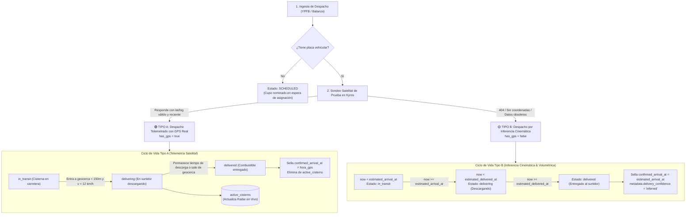
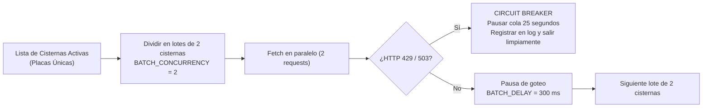

# 🛰️ Plan Maestro: Sistema de Despachos, Telemetría GPS y Seguimiento en Tiempo Real (Surtiveo)

> [!NOTE]
> **DOCUMENTO CONSOLIDADO EN EL DOCUMENTO MAESTRO:**  
> Este documento ha sido fusionado integralmente con los nuevos descubrimientos de la API de Kyros, el esquema DDL y las fórmulas de cascada en:  
> 📄 **[dispatch.md](dispatch.md)**.  
> Por favor consultar `dispatch.md` como la única fuente de verdad técnica y de producción.

> **Documento de Arquitectura, Diagnóstico y Planificación Técnica**  
> **Fecha:** 27 de Octubre de 2026  
> **Estado:** Propuesta de Refactorización y Blindaje Integral  
> **Componentes analizados:** `ingestar_despachos_ypfb.py`, `verificar_proximidad_cisternas.py`, tabla `dispatches`, tabla `active_cisterns`, API Kyros, App Móvil.

---

## 1. Diagnóstico Exhaustivo del Sistema Actual

Tras la auditoría completa del código fuente de los dos motores backend (`ingestar_despachos_ypfb.py` con 907 líneas y `verificar_proximidad_cisternas.py` con 792 líneas) y de las 8,390 filas reales en la tabla `dispatches` de Supabase, se identificaron los siguientes puntos críticos:

### 1.1. Lo que el sistema YA HACE BIEN ✅

1. **Ingesta y Deduplicación Idempotente**:
   - `ingestar_despachos_ypfb.py` genera un hash MD5 unívoco (`unique_hash`) combinando distrito, fecha, estación/marca, combustible, placa y litros.
   - La función `reclaim_plate_assignments` evita duplicar filas cuando un cupo programado sin placa recibe placa más tarde.
   - El upsert por lotes en `public.dispatches` respeta los estados avanzados (`delivering`, `delivered`) para que una re-ingesta no revierta una entrega confirmada.
2. **Homologación de Estaciones en Memoria $O(1)$**:
   - `StationMatcher` utiliza `stations.ypfb_names (text[])`, `stations.name` y `stations.anh_name`. No hace búsquedas difusas lentas ni falsos positivos; si no coincide, asigna `station_id = NULL` limpiamente sin perder el despacho.
3. **Cálculo Físico de Rutas ($0 OSRM / Haversine)**:
   - Consulta el servicio OSRM para obtener la polilínea codificada y duración real por carretera, persistiendo el resultado en `osrm_routes_cache.json`.
   - Si OSRM falla o no responde, entra en juego el fallback geodésico Haversine con curvatura topográfica (llano vs montaña) y factor de camión cisterna pesado (`TRUCK_TIME_FACTOR = 1.45` + buffer de 15 min en balanza).
4. **Geocercas de Detección en Proximidad**:
   - `verificar_proximidad_cisternas.py` implementa geocercas concéntricas:
     - Geocerca de arribo: $\le 120\text{ m}$ con velocidad $\le 12\text{ km/h}$.
     - Zona de permanencia (dwell zone): $\le 400\text{ m}$ con velocidad $\le 5\text{ km/h}$ por $\ge 4\text{ min}$.

---

### 1.2. Lo que el sistema HACE MAL o TIENE DEFICIENTE ⚠️

| Problema Identificado | Causa en Código | Impacto en Producción / UX |
| :--- | :--- | :--- |
| **1. Cientos de despachos congelados en `loading`** | `ingestar_despachos_ypfb.py` línea 455:<br>`status = "loading" if plate else "scheduled"`.<br>Y el scraper de proximidad **sólo consulta**:<br>`.in_("status", ["in_transit", "delivering"])`. | Hay **más de 392 despachos** que cumplieron su fecha, tienen placa pero como YPFB nunca pobló `fecha_despacho_efectivo_hora`, el motor de proximidad **jamás los evalúa** y quedan congelados en la app móvil con animación de carga infinita. |
| **2. Falsa expectativa de GPS (`has_gps = bool(plate)`)** | `ingestar_despachos_ypfb.py` línea 379:<br>`has_gps = bool(plate)`. | Asume que **cualquier cisterna con placa boliviana tiene GPS satelital**. En la realidad, muchas cisternas privadas o de terceros NO transmiten a Kyros. La app muestra el botón de rastreo, pero el mapa nunca recibe coordenadas. |
| **3. Bombardeo y sanción HTTP 429 en la API de Kyros** | `verificar_proximidad_cisternas.py` líneas 330-365:<br>8 hilos paralelos, pausa de solo 0.1s y múltiples intentos mutando la placa (`1123-SYU`, `1123SYU`, `1123-SYU 1`). | La API de Kyros corre sobre Uvicorn y satura rápidamente. Al recibir ráfagas concurrentes devuelve `429 Too Many Requests` o bloquea la IP. |
| **4. Circuit Breaker destructor** | `verificar_proximidad_cisternas.py` línea 357:<br>`if consecutive_errors >= 12: break`. | Si 12 cisternas seguidas fallan (por 429 o porque no tienen GPS), el script **aborta por completo el ciclo**, dejando sin rastrear al resto de cisternas de todo el país durante esa corrida. |
| **5. Cero despachos en `active_cisterns`** | La tabla `public.active_cisterns` tiene **0 filas en producción**. | El radar en tiempo real no está poblado; las cisternas no se visualizan como flota viva en el mapa global. |
| **6. No existe transición por tiempo para camiones sin GPS** | Si una cisterna no tiene GPS o pierde señal, el script no tiene un ciclo de vida automático para pasar de `in_transit` $\to$ `delivering` $\to$ `delivered` basado en la hora estimada de llegada y el tiempo de descarga. | Los despachos sin GPS quedan en `in_transit` durante 72 horas hasta que un script de limpieza forzosa los pasa a `cancelled`. |
| **7. Falta de Cron Automatizado en GitHub Actions** | Los workflows `.github/workflows/asdfghjkl.yml` y `proximidad.yml` solo tienen `on: workflow_dispatch`. | No tienen un trigger programado (`schedule: - cron: '*/5 * * * *'`), dependiendo de ejecuciones manuales o llamadas externas no monitoreadas. |

---

## 2. La Solución Arquitectónica: Modelo Dual de Despachos

En el ecosistema logístico boliviano existen dos realidades operativas bien diferenciadas que nuestro sistema debe formalizar:



---

### 2.1. Despacho Tipo A: Con Telemetría GPS Real (`has_gps = true`)
- **Criterio de Asignación**: Se marca `has_gps = true` **únicamente** si la API de Kyros devuelve coordenadas válidas (`latitud != 0`, `longitud != 0`) y la telemetría tiene una antigüedad menor a 12 horas.
- **Seguimiento**:
  - Se consulta su posición cada 5 minutos mediante la técnica de goteo secuencial.
  - Se actualiza el gemelo digital en `public.active_cisterns` (`latitude`, `longitude`, `speed_kmh`, `heading`, `is_moving`).
  - La llegada se confirma cuando la cisterna entra en la geocerca de la estación ($\le 150\text{ m}$) a baja velocidad ($\le 12\text{ km/h}$).
  - `confirmed_arrival_at` se sella con el `hora_gps` oficial reportado por el satélite.
  - El tiempo de descarga en estación se monitorea; al terminar o alejarse del surtidor, pasa a `delivered` y se retira de `active_cisterns`.

---

### 2.2. Despacho Tipo B: Por Inferencia Cinemática y Volumétrica (`has_gps = false`)
- **Criterio de Asignación**: Cisternas sin GPS o cuya placa no existe en la base de datos de Kyros.
- **Cálculo de Tiempos**:
  1. **Hora de Salida (`dispatched_at`)**: Si YPFB no reportó hora exacta pero hay placa asignada para hoy, se toma la hora de creación/programación o se estima el horario de turno de planta.
  2. **Hora Estimada de Llegada (`estimated_arrival_at`)**:
     $$\text{estimated\_arrival\_at} = \text{dispatched\_at} + \text{duración OSRM/Haversine}$$
  3. **Tiempo de Descarga Volumétrica ($\Delta t_{\text{descarga}}$)**:
     El vaciado de tanques de combustible por gravedad y manguera de 3" tiene una velocidad física conocida:
     - Hasta $10,000\text{ L}$ $\to$ **35 minutos**.
     - De $10,001$ a $15,000\text{ L}$ $\to$ **45 minutos**.
     - De $15,001$ a $24,000\text{ L}$ $\to$ **65 minutos**.
     - Más de $24,000\text{ L}$ $\to$ **80 minutos**.
  4. **Hora Estimada de Entrega (`estimated_delivered_at`)**:
     $$\text{estimated\_delivered\_at} = \text{estimated\_arrival\_at} + \Delta t_{\text{descarga}}$$
- **Transición de Estados Automática**:
  - Si $\text{now} < \text{estimated\_arrival\_at}$ $\implies$ **`in_transit`** (En camino).
  - Si $\text{estimated\_arrival\_at} \le \text{now} < \text{estimated\_delivered\_at}$ $\implies$ **`delivering`** (Descargando en surtidor).
  - Si $\text{now} \ge \text{estimated\_delivered\_at}$ $\implies$ **`delivered`** (Entregado, combustible disponible para la venta).
- **Resultado Inmediato**: **Cero despachos atascados en `loading` o `in_transit`**. Los 392 despachos que hoy están huérfanos se resolverán limpiamente siguiendo su curva de tiempo natural.

---

## 3. Blindaje del Scraper y de la API de Kyros

Para que el script que corre cada 5 minutos no sea sancionado con HTTP 429 ni consuma recursos excesivos, se aplicarán las mismas directrices de ingeniería que validamos en el frontend:



### 3.1. Reglas de Petición
1. **Sin Mutaciones de Placa**: Se consulta la placa exactamente como viene de la base de datos (`cleanPlate`: mayúsculas y sin espacios adicionales). Cero intentos duplicados con/sin guiones.
2. **Concurrencia Estricta**: Máximo 2 peticiones en vuelo simultáneamente (`asyncio.Semaphore(2)`).
3. **Pausa entre Lotes (Pacing)**: Espera controlada de `300 ms` entre cada lote de 2 peticiones.
4. **Respuesta ante HTTP 429**: Si Kyros devuelve 429 en cualquier momento, el script:
   - Suspende inmediatamente el sondeo de placas restantes.
   - Aplica un cooldown en memoria de 25 segundos.
   - Procesa los datos obtenidos hasta ese momento y finaliza la ejecución sin arrojar una excepción fatal.
   - Las placas no procesadas se retomarán en el siguiente ciclo de 5 minutos de forma natural.

---

## 4. Comparativa de Cambios en la Base de Datos y Scrapers

| Archivo / Componente | Estado Actual | Estado Propuesto (Refactorizado) |
| :--- | :--- | :--- |
| `dispatches.has_gps` | `bool(plate)` (Siempre `True` si tiene placa). | `True` únicamente si Kyros valida que transmite telemetría. De lo contrario `False`. |
| `dispatches.status` | `loading` infinito si no tiene hora efectiva de salida. | `loading` pasa automáticamente a `in_transit` al llegar la hora de salida, y luego a `delivering` y `delivered`. |
| `verificar_proximidad_cisternas.py` | Solo filtra `in_transit` y `delivering`. Ignora `loading`. | Evalúa `loading`, `in_transit` y `delivering`. Despachos sin GPS se procesan por inferencia de tiempo. |
| Manejo de Errores Kyros | Circuit breaker aborta todo tras 12 fallos consecutivos. | Goteo secuencial (concurrencia 2, delay 300ms) y backoff ante 429 sin abortar registros previos. |
| `active_cisterns` | Vacía (0 registros). | Mantiene el radar satelital vivo de los camiones actualmente en ruta con GPS. |
| Workflows GitHub Actions | `on: workflow_dispatch` (Manual). | `schedule: - cron: '*/5 * * * *'` para proximidad y `*/15 * * * *` para ingesta general. |

---

## 5. Plan de Ejecución Paso a Paso

### Fase 1: Limpieza y Normalización de Datos Existentes (SQL en Supabase)
1. Ejecutar script de saneamiento sobre `public.dispatches`:
   - Marcar como `delivered` los despachos con más de 24 horas de antigüedad que quedaron congelados en `loading` o `in_transit`.
   - Ajustar `has_gps = false` para aquellos despachos cuyas placas nunca han devuelto un ping satelital.

### Fase 2: Refactorización de `ingestar_despachos_ypfb.py`
1. Reemplazar `has_gps = bool(plate)` por validación real de telemetría (o valor por defecto pendiente de confirmación por el monitor de proximidad).
2. Incorporar el cálculo de tiempo de descarga volumétrica ($\Delta t_{\text{descarga}}$) en los metadatos del despacho.
3. Asegurar que los despachos con placa pero sin hora efectiva inicien en `loading` con una ventana de auto-activación temporal hacia `in_transit`.

### Fase 3: Refactorización de `verificar_proximidad_cisternas.py`
1. Implementar la arquitectura dual:
   - **Módulo GPS**: Sondeo con goteo (2 concurrentes, 300ms delay, anti-429).
   - **Módulo Inferencia**: Actualización automática de estados por tiempo transcurrido para despachos sin GPS o con GPS offline.
2. Población y mantenimiento en tiempo real de `public.active_cisterns`.
3. Sellar `confirmed_arrival_at` y `metadata.delivery_confidence` (`'gps'` vs `'inferred'`).

### Fase 4: Configuración de Automatización y Crons
1. Configurar en `.github/workflows/proximidad.yml` el cron cada 5 minutos:
   ```yaml
   on:
     schedule:
       - cron: '*/5 * * * *'
     workflow_dispatch:
   ```
2. Configurar en `.github/workflows/asdfghjkl.yml` el cron cada 15 minutos para la ingesta de nuevos cupos de YPFB:
   ```yaml
   on:
     schedule:
       - cron: '*/15 * * * *'
     workflow_dispatch:
   ```
3. Verificar la ejecución limpia con los secretos de entorno (`V3`, `V4`).

---

## 6. Conclusión y Beneficio Directo

Con este diseño arquitectónico:
1. **La UI de la App Móvil será 100% confiable**: El usuario verá la hora real confirmada si tiene GPS, o la estimación cinemática exacta si no lo tiene. Desaparece por completo el problema de los despachos eternamente en "cargando".
2. **Cero sanciones de la API de Kyros**: El tráfico saliente será suave, dosificado y resistente a errores 429.
3. **Costo de Infraestructura $0**: Se mantiene dentro de los límites gratuitos de Supabase y GitHub Actions, utilizando OSRM cacheado y geocercas matemáticas en memoria.
